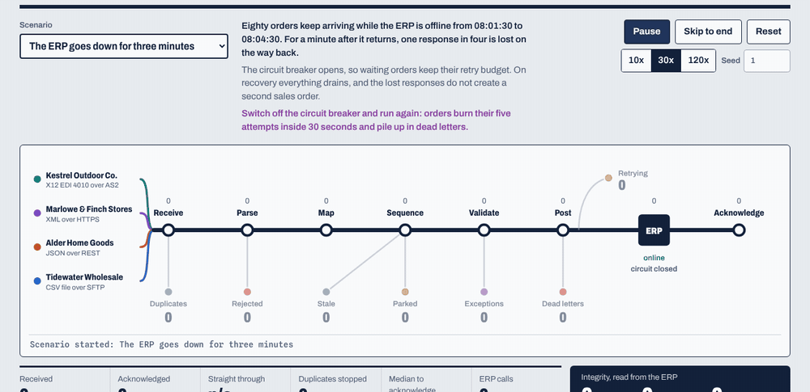
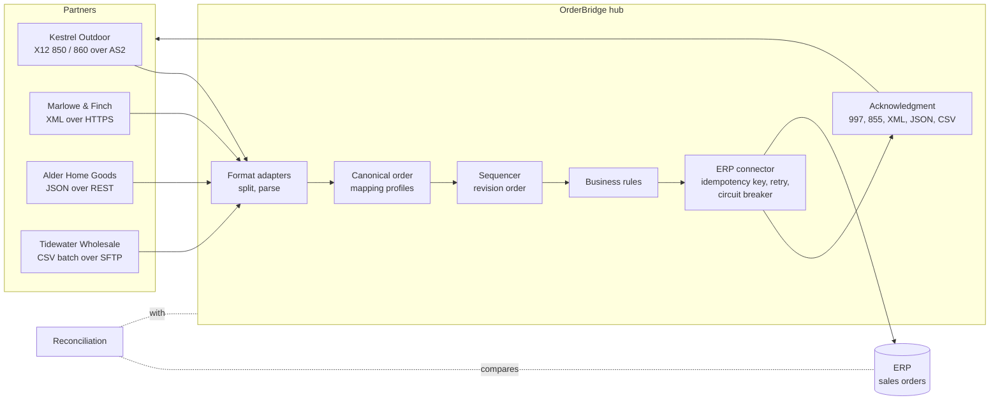
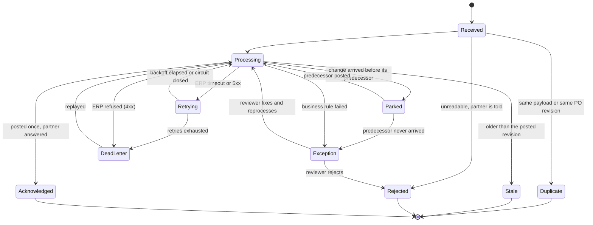
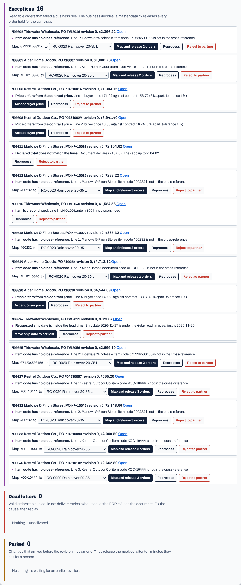
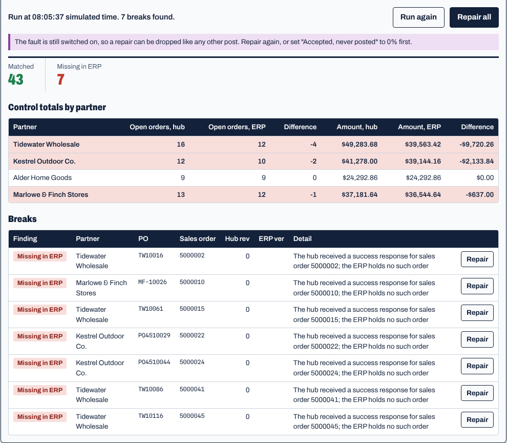
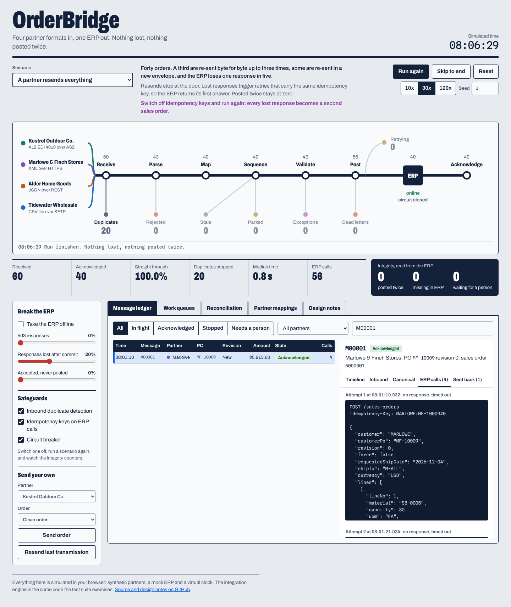

# OrderBridge

**A working reference implementation of an ERP order-integration hub.** Four trading partners send purchase orders in four formats over four channels. One ERP receives them. Nothing is lost and nothing is posted twice, including when the ERP goes down, loses responses, or accepts a document and then fails to post it.

**[Open the live control room](https://hemanthc97.github.io/orderbridge/)** and run a scenario. No install, no sign-in.

[](https://github.com/hemanthc97/orderbridge/actions/workflows/ci.yml)



## Why this exists

Most integration demos show the happy path: a message goes in, a record comes out. Order integration is hard for the other reasons:

- a partner's network resends a file three times
- the ERP commits an order and the response never arrives, so the caller retries
- a change order is delivered before the order it changes
- an item code has no cross-reference yet
- the ERP answers "created" and its own posting job then fails

OrderBridge implements the safeguards for each of these and lets you switch them off to see what they prevent.

## What it does



Every message ends in exactly one named state. None can disappear between stages.



## Seven scenarios, seven failure modes

Each scenario is seeded and reproducible. The figures below are from `node cli/run.js all --seed 3`.

| Scenario | What goes wrong | What handles it | Result |
|---|---|---|---|
| A normal trading day | 3% of ERP calls return 503 | Retry with backoff | 60 of 60 acknowledged |
| The ERP goes down for three minutes | Three-minute outage, then a quarter of responses lost | Circuit breaker, idempotency keys | 80 of 80 acknowledged, 0 dead letters |
| A partner resends everything | Byte-identical resends, re-enveloped resends, 20% of responses lost | Payload hash, business key, idempotency key | 30 duplicates stopped, 0 posted twice |
| Bad data from partners | Unknown items, off-contract prices, short lead times, broken files | Syntax reject, exception queue | 26 posted, 18 held for a decision, 1 rejected |
| Changes arrive out of order | Changes delivered before originals, one orphan change | Sequencer parks and releases | 48 of 49 applied in order, 1 held |
| The ERP says yes and posts nothing | ERP returns success, then drops 12% of documents | Reconciliation and repair | 5 missing orders found and reposted |
| Peak load with everything going wrong | 400 orders in six minutes with every fault at once | All of the above | 0 posted twice, 0 lost |

Switch off the circuit breaker and the outage scenario leaves 19 of 80 orders in dead letters. Switch off idempotency keys and the resend scenario creates 6 duplicate sales orders.





## The control room

| View | What it shows |
|---|---|
| Line map | Live flow from four partners through seven stages to the ERP, with side tracks for duplicates, rejects, parked changes, exceptions, retries and dead letters |
| Integrity band | Two numbers read from the ERP's own data: orders posted twice, orders missing |
| Message ledger | Every message, with its timeline, the raw inbound payload, the canonical order, each ERP call with its idempotency key, and the documents sent back |
| Work queues | Exceptions with a fix beside each, dead letters with replay, parked changes |
| Reconciliation | Order-level comparison, control totals by partner, one-click repair |
| Partner mappings | Field-by-field mapping from each wire format to the canonical order to the ERP request, plus the item cross-reference |
| Design notes | The nine decisions behind the design, what breaks without each, and what each costs |

The left panel breaks the ERP (offline, 503s, lost responses, silent posting failures) and switches each safeguard off.



## Run it

Requires Node.js 20 or later. There are no dependencies to install.

```bash
git clone https://github.com/hemanthc97/orderbridge.git
cd orderbridge

node cli/serve.js          # control room at http://localhost:8080
node --test                # 34 tests
node cli/run.js all        # every scenario, headless, with an integrity check
node cli/run.js outage --no-breaker --seed 7
node cli/run.js duplicates --no-idempotency --trace
```

## Design decisions

The full reasoning, with trade-offs, is in [docs/decisions.md](docs/decisions.md). In short:

1. **One canonical order.** Formats are translated at the edge. Rules and the ERP connector see one shape.
2. **Two acknowledgments.** A 997 says the file was readable. An 855 says the order was accepted.
3. **Three layers against duplicates.** Payload hash, business key (partner, PO, revision), idempotency key on the ERP call.
4. **Retry only what can pass.** Timeouts and 5xx retry with backoff and jitter. A 4xx goes to dead letters at once.
5. **A circuit breaker that protects retry budgets.** Waiting orders spend no attempts while the ERP is down.
6. **Two queues because two people own them.** Exceptions for the business, dead letters for the integration team.
7. **Changes apply in revision order.** Early changes are parked and released. Deltas and full replacements end as one document.
8. **Reconciliation is a control.** It is the only thing that finds an order the ERP acknowledged and never posted.
9. **A simulation you can replay.** Virtual clock, seeded randomness, identical results in the browser and in tests.

A five-minute guided tour is in [docs/walkthrough.md](docs/walkthrough.md).

## Repository layout

```
src/
  formats/x12.js      X12 004010: read 850 and 860, write 997 and 855
  formats/xml.js      dependency-free XML reader
  formats/index.js    XML, JSON and CSV adapters, acknowledgment writers
  canonical.js        canonical order, mapping, delta application
  rules.js            business validation
  hub.js              the seven-stage pipeline and its queues
  reliability.js      retry policy, circuit breaker
  erp.js              mock ERP with four failure modes
  reconcile.js        reconciliation and repair
  generator.js        synthetic partner traffic, including defects
  scenarios.js        the seven scripted scenarios
web/                  the control room (no framework, no build step)
cli/                  headless scenario runner, local static server
test/                 34 tests on the Node.js built-in runner
docs/                 design decisions, walkthrough
```

## What is real and what is simulated

**Real:** the parsing, mapping, validation, sequencing, retry, circuit-breaker, idempotency and reconciliation logic. The browser and the test suite run the same modules.

**Simulated:** the partners, the ERP, the network and the clock. All company names, items, prices and orders are invented.

| In this repository | In production |
|---|---|
| Scheduler and in-memory message list | A durable queue with delayed delivery and a dead-letter queue |
| In-memory maps for hashes, order state and idempotency keys | A relational store with unique constraints on the business key |
| Mock ERP | The ERP connector: IDoc or OData for SAP, ION BODs or M3 APIs for Infor, REST for cloud ERPs |
| `ingest()` called directly | An AS2 endpoint or VAN mailbox, an HTTPS API behind a gateway, an SFTP poller |

## Scope and limits

- The X12 support is a subset of version 004010 (850, 860, 855, 997), written for study. It is not a certified translator, and real partners publish implementation guides that narrow or extend the standard.
- State is held in memory in one process. Production needs durable storage and locking on the order key.
- One circuit breaker covers the whole ERP. A breaker per endpoint would isolate failures better.
- Security, authentication and partner onboarding are out of scope.

## Author

Hemanth Penumala. Built with Claude Code as a pair programmer.

Released under the [MIT License](LICENSE).
